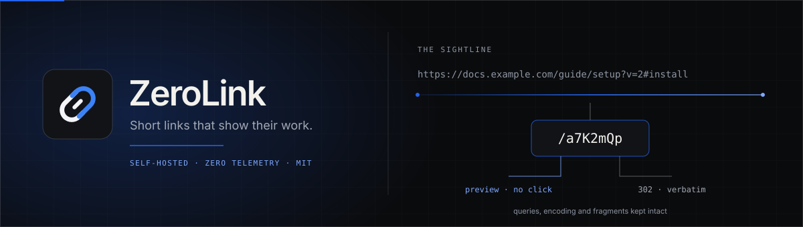
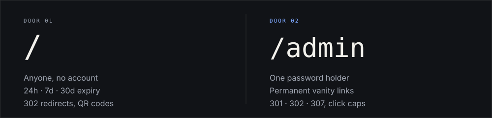
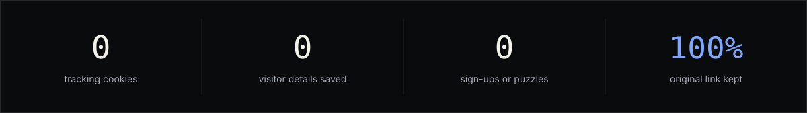
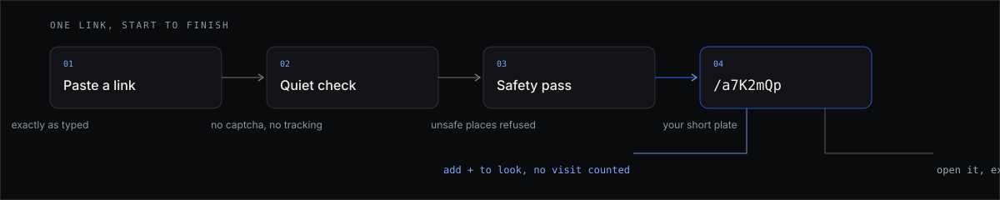
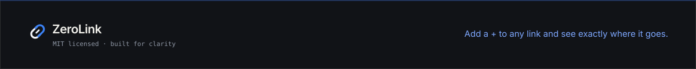

  

<h1 align="center">ZeroLink</h1>

<em>Short links that show their work.</em>

  <a href="#the-idea">The idea</a> · <a href="#two-doors-one-server">Two doors</a> · <a href="#the-journey">The journey</a> · <a href="#privacy-in-plain-words">Privacy</a> · <a href="#safety-without-friction">Safety</a> · <a href="#get-started">Get started</a> · <a href="#host-it">Host it</a> · <a href="#notes">Notes</a>

---

> Most shorteners ask you to trust a black box. ZeroLink keeps the whole destination intact, lets anyone look before they click, and leaves the visitor alone. One small deployment, two ways to use it, nothing sent elsewhere.

Free and open source under MIT &nbsp;·&nbsp; built with Next.js, TypeScript and PostgreSQL

## The idea

Short links should be honest. The original address is never rewritten, clipped or cleaned up, and every link has a way to be inspected before anyone opens it. The owner gets a private workspace; everybody else gets a simple box to paste a link into.

## Two doors, one server

  

One deployment, two very different jobs

Public links are disposable and watched by the community. Owner links are the ones on your business card, and a stray report cannot switch them off.

In the private workspace the owner can pause public creation, stop visit counting, reserve custom endings and change the default lifetime. Links can be created with a quick-create shortcut, edited, paused, given notes, and moved in or out through JSON or CSV files.

## What you get

|  **Make it short** |  **Look before you click** |  **Leave no trail** |
|---|---|---|
| Clean links in seconds, custom endings, downloadable QR codes | Add `+` to any link to see the destination without a visit counted | No cookies, no visitor profile, no outside services |

  

The numbers that matter, on every public page

## The journey

  

A short link, start to finish

Your address goes in exactly as you typed it. A small puzzle keeps automated traffic out without a captcha, the destination is checked for unsafe places, and a short plate comes back. Add a plus sign to that plate to inspect it without registering a visit. The preview shows the full destination, whether it is an owner or public link, its status, its dates and its visit count, with a button to continue or unlock. Open the plate itself and the browser is sent to the original address, unchanged, including its search filters and page anchors.

Owner links can also carry a visit limit, an end date, a password and a note. Public links choose how long they live: a day, a week, a month, or the site default.

## Privacy, in plain words

| We keep | We never keep |
|---|---|
| The destination, exactly as pasted | Where visitors came from |
| One simple visit total, if counting is on | IP addresses, devices or locations |
| The short name, its status and dates | Cookies for visitors |
| Passwords as hashes, where one is set | Analytics, ad pixels or outside scripts |

Fonts are part of the project, QR codes are drawn here, and the public path contacts no outside service. Redirects also ask browsers not to pass along a referrer.

## Safety without friction

| Concern | How it is handled |
|---|---|
| Harmful destinations | Only ordinary web addresses are accepted. Local and private addresses, hidden address formats and links back to this site are refused. |
| Bot traffic | A signed puzzle runs quietly in the background, a hidden field catches scripts, and each solved puzzle can only be used once. |
| Flooding | Shortening allows twenty requests per quarter hour, reports ten, sign-ins five and password attempts ten. The key rotates daily and addresses are never stored. |
| Reports | A report pauses a public link for review. Owner links are never paused by reports, and the owner can block a whole website. |
| Owner sign-in | Passwords are hashed with scrypt, sessions are signed and locked to the browser, and attempts are limited. |
| Browser rules | Strict rules stop framing, content sniffing and outside scripts; HTTPS is enforced in production. |
| Spreadsheet exports | Files are guarded so cell contents cannot run as formulas when opened. |
| Cached redirects | Links with an expiry or visit limit use temporary redirects, so browsers cannot hold on to a stale destination. |

## Get started

1. Copy the project with `git clone https://github.com/w1tneess/zerolink.git` and enter the folder with `cd zerolink`.
2. Install dependencies with `npm install`.
3. Make your configuration file with `cp .env.example .env`.
4. Create an owner password hash with `npm run hash-password -- "your strong password"` and a session key with `node -e "console.log(require('crypto').randomBytes(32).toString('hex'))"`.
5. Start the site with `npm run dev`.

Open `http://localhost:3000` for the public page and `http://localhost:3000/admin` for the owner workspace. Local development uses an embedded PostgreSQL database (`./data/pgdata`); its tables are created on first run, so there is no separate setup step.

<b>Every setting, explained</b>

| Setting | What it does | Default |
|---|---|---|
| `APP_BASE_URL` | Public address of your site, used for short links and safety checks | `http://localhost:3000` |
| `DATABASE_DRIVER` | `pglite` (embedded, local) or `neon` (serverless, for Vercel) | `pglite` |
| `DATABASE_URL` | Local data directory, or a Neon `postgres://…` connection string | `./data/pgdata` |
| `ADMIN_PASSWORD_HASH` | Hashed owner password for the private workspace | unset |
| `SESSION_SECRET` | Signs owner sessions and puzzles. Required in production | unset |
| `POW_SECRET` | A separate puzzle key, if you want one | follows the session key |
| `POW_DIFFICULTY` | How much work a puzzle takes, from 4 to 24 | `16` |
| `DEFAULT_REDIRECT_CODE` | Default redirect type for permanent or temporary links | `302` |

## Host it

### On Vercel

1. Create a [Neon](https://neon.tech) Postgres database (or use the Neon integration from the Vercel Marketplace).
2. Import the project into Vercel. Framework detection picks up Next.js automatically; no build command override is needed.
3. Set these environment variables in the Vercel project:
   - `DATABASE_DRIVER=neon`
   - `DATABASE_URL` — the Neon connection string (pooled endpoint)
   - `SESSION_SECRET` — a random 32+ byte hex string, the same for every deployment
   - `ADMIN_PASSWORD_HASH` — from `npm run hash-password -- "your strong password"`
   - `APP_BASE_URL` — your public `https://` address
4. Deploy. Tables are created idempotently on first request, so no migration step is required.

Rate-limit buckets and spent proof-of-work challenges are stored in the same database, so limits and replay protection hold across every serverless instance. The daily key rotation is derived from `SESSION_SECRET`, which is why that value must be stable across deployments.

### As a container

Build and start with `docker compose up -d --build`. It is a standalone build on Node 22, runs as an unprivileged user, keeps the embedded database in a persistent volume and checks its own health every half minute. Put Caddy or Nginx in front for HTTPS and set `APP_BASE_URL` to your public address.

<b>Before you scale up</b>

A single container can use embedded PGlite; multiple instances or a serverless deployment need Neon. Request limits and solved puzzles are shared through database tables, so adding nodes does not weaken protection.

## Notes

<b>Honest limitations</b>

- One owner by design; there are no user accounts or team roles.
- Only the server owner can edit or remove a link. Public reports pause public links, and the owner can restore them.
- Visit counts are totals only. There is no per-visitor analytics because there are no per-visitor records.
- Two database drivers are supported: embedded PGlite for local/container use and Neon HTTP for serverless deployments.
- A permanent redirect is never used for a link with an expiry or visit limit, because browsers cache permanent redirects.

<b>For developers: the addresses</b>

| Address | What it does |
|---|---|
| `/` | Public shortener with a live sightline preview |
| `/<slug>` | Redirect, password gate, or an unavailable page |
| `/<slug>+` and `?preview=true` | Safe inspection, without counting a visit |
| `/unlock/<slug>` | Password entry for a protected link |
| `/report` | Anonymous abuse reporting |
| `/admin` and `/admin/login` | Owner workspace and sign-in |
| `/api/shorten`, `/api/report` | Create a link, send a report |
| `/api/pow/challenge` | Issue a puzzle |
| `/api/auth/*` | Sign in, sign out, check session |
| `/api/admin/*` | Links, moderation, blocklist, settings, import and export |
| `/api/health` | Health check used by the container |
| `/robots.txt`, `/sitemap.xml` | Crawl rules and generated sitemap |

Owner actions are protected by a signed browser cookie. A quick-create shortcut is available with Ctrl+K or Cmd+K.

Twenty-six automated tests cover address fidelity, unsafe address formats, custom endings, puzzle replay, request limits and both doors of the site. They use a temporary database and never touch your real data.

[Design system](./DESIGN.md) · [Security policy](./SECURITY.md) · [MIT license](./LICENSE)

  

